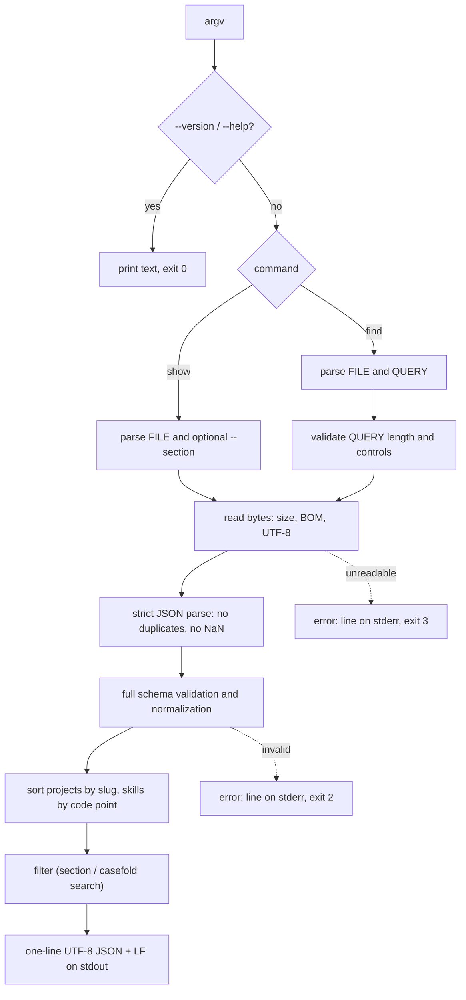

# offline-portfolio-cli

A non-interactive terminal portfolio that reads a local JSON file. It prints
data as UTF-8 JSON on stdout, never touches the network, and ships no embedded
personal data. Product version **0.1.0**, spec version **0.1.4**.

## Problem and scope

The original idea (#33) was a portfolio distributed with `npx`. This product is
deliberately smaller: a single standard-library Python CLI, run offline, with
all content supplied by a file the user owns. There is no `npx` publication, no
download, no browser, and no interactivity.

In scope:

- `show FILE` — print the whole validated portfolio object.
- `show FILE --section profile|projects|skills` — print only that piece.
- `find FILE QUERY` — case-insensitive substring search over project titles and
  descriptions, returning matching projects sorted by slug.
- `--version` and `--help`, usable without any file.

Out of scope: a server/HTTP mode, interactive editing, persistence, accounts,
telemetry, and npm distribution.

## Quickstart

Requires Python 3.12. No runtime dependencies, no installation step.

```console
$ cat portfolio.json
{"profile":{"name":"Demo","bio":"Local"},"projects":[{"slug":"demo","title":"Demo","description":"Exemplo"}],"skills":["Python"]}

$ python app show portfolio.json
{"profile":{"name":"Demo","bio":"Local"},"projects":[{"slug":"demo","title":"Demo","description":"Exemplo"}],"skills":["Python"]}

$ python app show portfolio.json --section skills
["Python"]

$ python app find portfolio.json exemplo
[{"slug":"demo","title":"Demo","description":"Exemplo"}]

$ python app find portfolio.json absent
[]

$ python app --version
offline-portfolio-cli 0.1.0
```

On POSIX the executable `./app` behaves exactly like `python app`. On Windows
use `python app` or the `app.cmd` launcher, which forwards arguments (including
paths with spaces) and the exit code.

## Input schema

`FILE` is a UTF-8 JSON object (no BOM) of at most 1048576 bytes with exactly
three keys:

```json
{
  "profile": {"name": "Demo", "bio": "Local"},
  "projects": [
    {"slug": "demo", "title": "Demo", "description": "Exemplo"}
  ],
  "skills": ["Python"]
}
```

- `profile`: exactly `name` (1..80 characters) and `bio` (0..2000).
- `projects`: 0..100 objects, each with exactly `slug`, `title`, `description`.
  `slug` is ASCII `[a-z][a-z0-9-]{0,31}` and unique; `title` is 1..120
  characters; `description` is 0..2000.
- `skills`: 0..100 unique strings of 1..80 characters (exact comparison).
- All text rejects controls U+0000..U+001F and U+007F. Spaces, NBSP and
  non-control Unicode are kept verbatim; no trimming or Unicode normalization.
- Extra keys, wrong types, duplicate keys, NaN/Infinity, invalid UTF-8 and a
  BOM are validation failures. The whole document is validated before any
  section filter or search runs.

Output arrays are sorted: projects by slug, skills by Unicode code point.
Search uses `casefold()` on both the query and the field, so `STRASSE` matches
`Straße`; the slug is not searched. JSON is emitted on one line followed by LF.

## CLI reference

```
usage: app show FILE [--section profile|projects|skills]
       app find FILE QUERY
       app --version
       app --help
```

| Invocation | Success output | Failure |
|---|---|---|
| `show FILE` | validated object | validation → 2, I/O → 3 |
| `show FILE --section VALUE` | only that value, no wrapper | validation → 2, I/O → 3 |
| `find FILE QUERY` | array of projects (possibly `[]`) | validation → 2, I/O → 3 |
| `--version` | `offline-portfolio-cli 0.1.0\n` | — |
| `--help` | usage text | — |

On success stdout carries only data, one JSON value plus LF, and stderr is
empty. On error stdout is empty and stderr is a single `error:` line with no
traceback. Unknown or missing arguments and invalid input exit 2; file
open/read failures exit 3.

## How it works



The program is intentionally a single file, `app`, with no runtime
dependencies. Reading is complete before any output; the input file is never
modified or written.

## Limits and platform

- **Platforms:** native Windows and Ubuntu, Python 3.12, tested on
  `windows-latest` and `ubuntu-latest`. WSL, Bash and GNU coreutils are not
  required on Windows. `PYTHONUTF8=1` is set in CI.
- **File size:** exactly 1048576 bytes is accepted; 1048577 is rejected.
- **Text encoding:** UTF-8 without BOM; stdout uses UTF-8 and LF.
- **No network, credentials, paid APIs, telemetry or shell interpolation.**
- Directories, symlinks and special devices are outside the contract.

## Tests and lint

Dev dependencies are pinned in `requirements-dev.txt`; tests install nothing.

```console
python -m pip install -r requirements-dev.txt
python -m ruff check .
python -m ruff format --check .
python -m pytest -q
```

The public suite in `tests/` is black-box: every case spawns the documented
entrypoint with `sys.executable` and asserts on stdout, stderr and exit code.
Test names and docstrings map to acceptance criteria AC-1..AC-12 and to the
ambiguity resolutions (BOM, invalid UTF-8, NaN, duplicate keys, 1 MiB boundary,
extra positionals, missing option values, NBSP/NFC-NFD).

## Decisions

- **Validation before output.** Loading and full-document validation happen
  before `--section` or search, so an invalid project fails even when the
  requested section is `profile`.
- **Strict JSON.** A custom `object_pairs_hook` rejects duplicate keys and
  `parse_constant` rejects NaN/Infinity; Python's permissive defaults alone
  would not satisfy the spec.
- **Byte-oriented output.** JSON is encoded and written through
  `sys.stdout.buffer`, guaranteeing UTF-8 and LF even when the console
  encoding differs.
- **Exact error surface.** Errors are one ASCII `error:` line; values from the
  input are never echoed, so control characters cannot leak to the terminal.
- **Read-only.** There is no state, cache or temporary file; the write-failure
  protocol of the spec does not apply to this CLI.

## How this was built

- **Implementation:** written by an AI coding agent in the Claude Code
  harness. Observed model reported by the harness for this run:
  `deepseek-flash`.
- **Public tests:** the tests in `tests/` were written in the implementation
  stage, driven by the specification and its acceptance criteria; they are
  regression tests, not an independent black-box audit.
- **Independent black-box tests:** per the delivery contract these are authored
  by a different AI agent/model family from the spec and are external to this
  clone (hidden); they are neither included nor consulted here.
- **Specification:** provided as issue #1, spec v0.1.4; the spec is a separate
  stage from the tests and the implementation.
- **Human participation:** the maintainer records actual corrections and
  editing; no human authorship is claimed here. No results beyond those
  observable in this repository (green local test run) are asserted.
